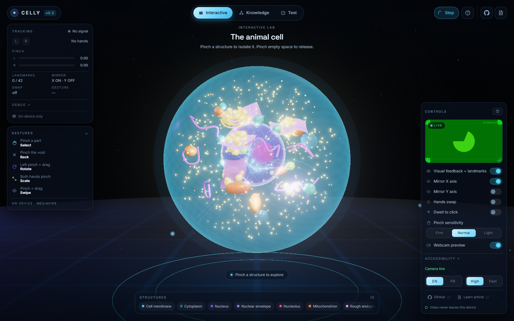
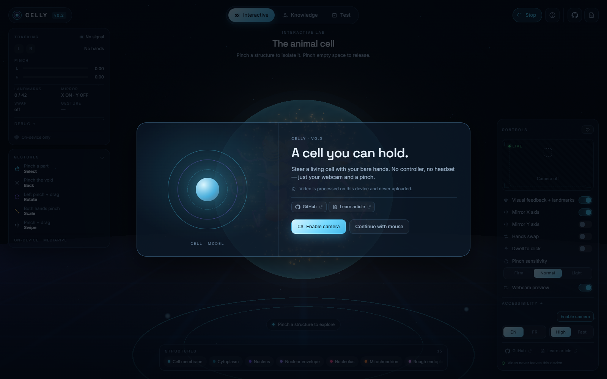
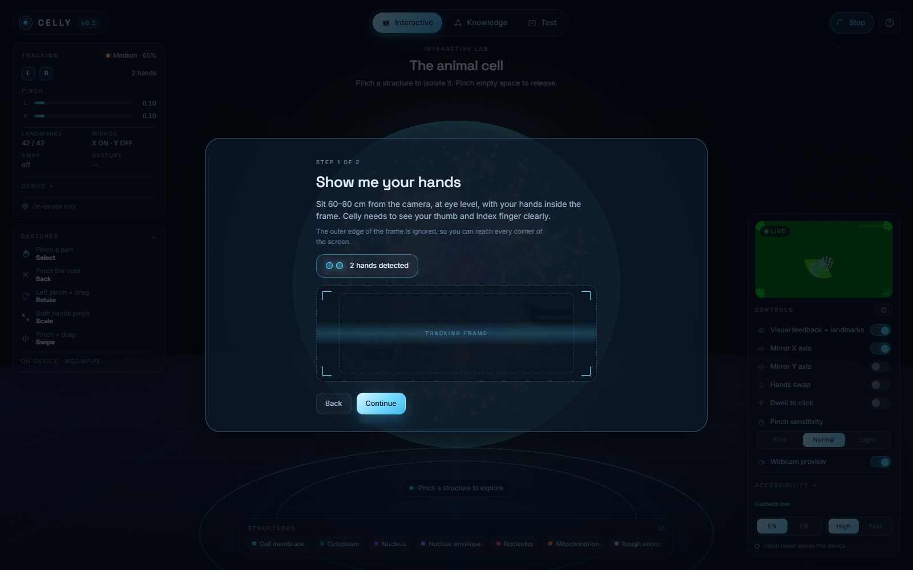
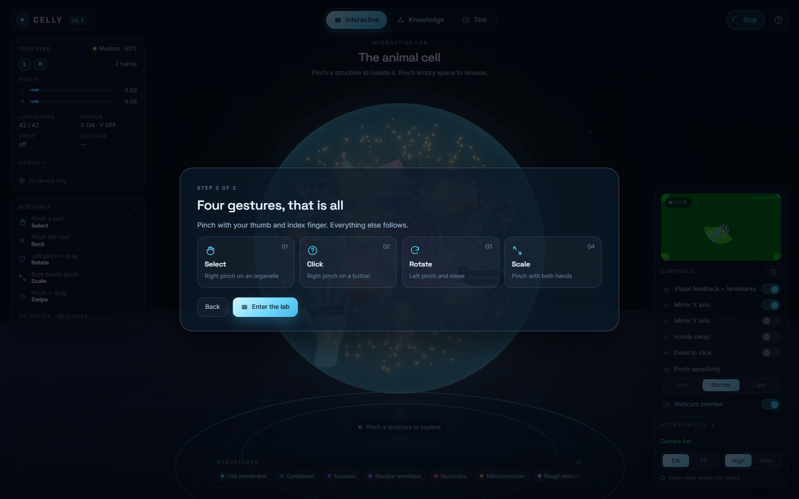
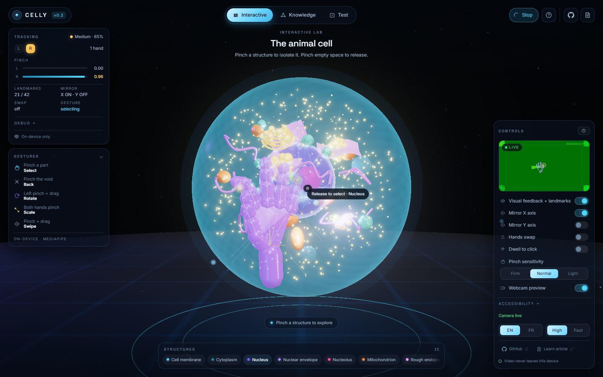
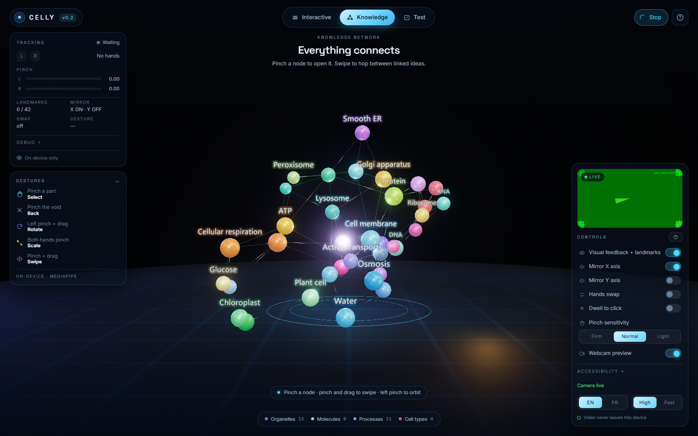
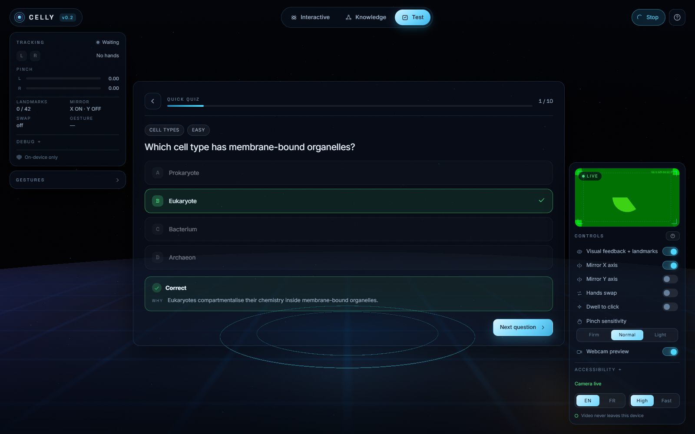
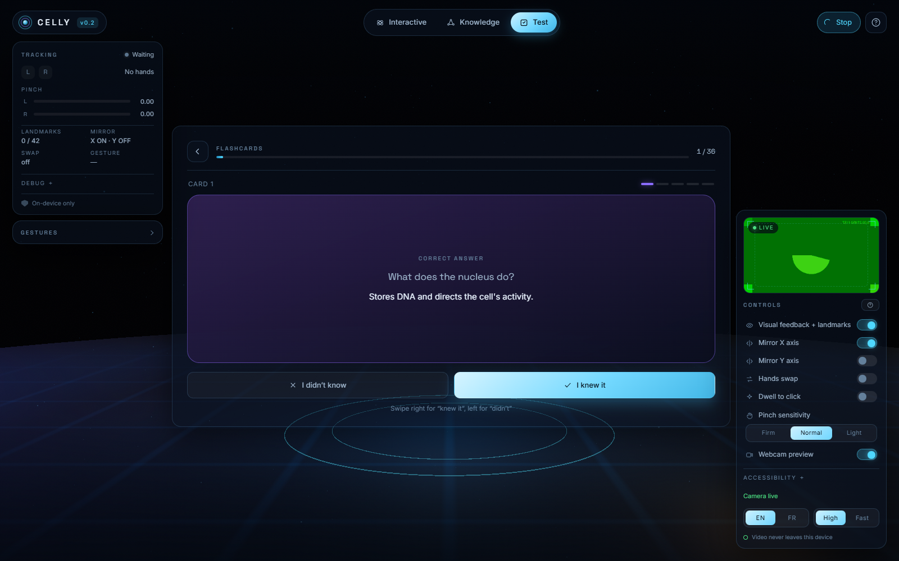
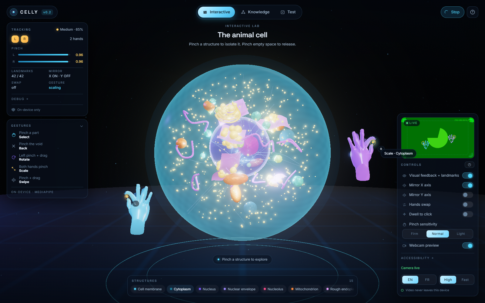
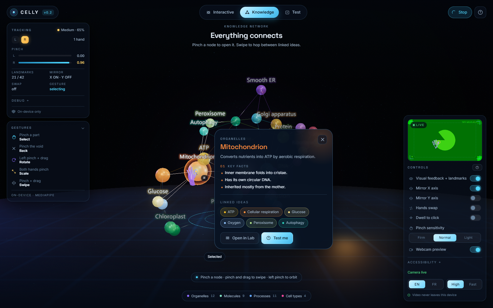

# Celly v0.2

**A touch-free 3D cell biology lab.** Celly puts a living, procedural cell in front of you and lets
you explore it with your **bare hands** — no controller, no headset, no gloves. A webcam and a pinch
are the entire interface, with the mouse and keyboard kept as a first-class fallback.

The app has three sections:

| Section | What you do |
|---|---|
| **Interactive Lab** | Rotate, scale, isolate and read 15 organelles on a ray-marched-looking 3D cell. |
| **Knowledge** | Fly through a 36-node graph of cell-biology concepts and hop between related ideas. |
| **Test** | Quick quiz, full exam, guided questionnaire sets and Leitner flashcards, all gesture-driven. |



---

## Contents

- [Quick start](#quick-start)
- [The gesture vocabulary](#the-gesture-vocabulary)
- [What is in the box](#what-is-in-the-box)
- [How hand tracking works](#how-hand-tracking-works)
- [Architecture](#architecture)
- [Testing](#testing)
- [Privacy](#privacy)
- [Accessibility](#accessibility)
- [Performance and browser support](#performance-and-browser-support)
- [Scripts](#scripts)
- [Documentation](#documentation)
- [Licence](#licence)

---

## Quick start

```bash
npm install
npm run dev          # http://localhost:5173
```

Requirements: **Node 20+**, a browser with **WebGL2** and **WASM**, and a webcam for gesture mode.
Chrome or Edge give the most predictable MediaPipe performance; Safari 17+ also works.

`npm install` runs `scripts/fetch-assets.mjs`, which

1. copies the MediaPipe WASM runtime out of the pinned npm package into `public/mediapipe-wasm/`,
2. downloads `public/models/hand_landmarker.task` (7.8 MB) once if it is missing, and
3. copies any vendored `hands_*.glb` files into `public/`.

Everything is served locally after that — no CDN, no per-frame network calls.

> **No camera?** Choose **Continue with mouse** on the welcome card. Every gesture has a pointer
> equivalent (click = pinch, drag = rotate, wheel = scale), so the app is fully usable without one.

### Production build

```bash
npm run build        # type-check + Vite build -> dist/
npm run preview      # serve dist/ locally
```

The build is static. Serve `dist/` behind HTTPS (or `localhost`) — browsers only grant camera access
in a secure context.

---

## The gesture vocabulary

| Gesture | Result |
|---|---|
| **Right pinch** on an organelle or node | **Select** — isolate, centre, open the info overlay |
| **Right pinch** on empty space | **Unselect** — restore the cell |
| **Right pinch** on a button | **Click** (release within 500 ms and 24 px) |
| **Left pinch + move** | **Rotate** the cell / graph |
| **Both hands pinch** | **Scale** — ratio-based, clamped per page |
| **Pinch + horizontal drag** | **Swipe** — next/previous (Knowledge and Test) |

Pinch strength is a dead-zoned ratio of tip gap to **palm width**, not to wrist length:

```
r     = |tip(4) - tip(8)| / |mcp(5) - mcp(17)|
pinch = 1 - smoothstep(0.10k, 0.55k, r)
```

`k` is the sensitivity chosen in the control panel — **Firm 0.8 / Normal 1.0 / Light 1.3** — so
the same hand can be tuned to a camera, a hand size or a lighting setup without touching code. The
image-space ratio is the primary signal; metric world landmarks are blended in only when they agree
with it, because MediaPipe's z is the noisiest axis at arm's length. Real finger pads touch while
the marker centres stay a centimetre or two apart, so the dead zone makes a natural pinch read 1
instead of stalling in the 0.5–0.6 range.

A pinch becomes active above **0.55**, releases below **0.38** (hysteresis), and must be held for
**70 ms**. Fists and incomplete hands are rejected. Losing the hand for less than **250 ms** does
not cancel a gesture.

Pointer movement maps the middle **84 %** of the camera frame (8 % → 92 %) onto the full viewport, a
~1.19× gain clamped at the edges, so every corner of the screen is reachable without leaning out of
frame. Sit **60–80 cm** back at eye level; the webcam preview and the onboarding hands check show the
usable frame as a dashed box.

The gesture state machine is `IDLE → HOVER_UI / SELECTING / ROTATING / SCALING / SWIPING`, with a
**150 ms cooldown** after a two-hand scale so the release cannot fire a stray select. A two-hand
pinch always overrides a rotate in progress.

The **HUD** (top-left) reports hands seen, L/R chips, live pinch value and bar, landmark count,
tracking quality (`Good / Medium / Poor` + %), mirror state, and both tracker and render FPS. The
gesture legend sits directly beneath it in the same left rail; it collapses automatically on short
viewports and on the Test page so telemetry never covers the question cards.

| Welcome | Hands check | Gesture primer |
|---|---|---|
|  |  |  |

---

## What is in the box

### Interactive Lab



- **15 organelles**, every one a separate, named, raycastable group: membrane, cytoplasm, nucleus,
  nuclear envelope, nucleolus, mitochondrion, rough ER, smooth ER, Golgi, ribosome, lysosome,
  vacuole, centriole, cytoskeleton, peroxisome.
- Auto-rotation on by default with a **Stop** control (top-right); the left hand rotates, two hands
  scale, and a pinch isolates.
- Selecting tweens the whole rig so the chosen part sits at the origin; everything else ghosts to
  8 % (opaque) / 3 % (translucent) instead of disappearing, so spatial context survives.
- A bottom **structure rail** lists all 15 parts for direct selection, in gesture or mouse mode.
- Per-organelle overlay: summary, functions, structure, fun fact, related parts, and a link to the
  matching knowledge node. The card docks to the side that fits between the HUD rail and the
  control panel, so it never covers either.

### Knowledge



- **36 authored nodes** (Organelles, Processes, Molecules, Techniques, Genetics) and ~90 edges in a
  deterministic 3D force layout — the same graph every load.
- Billboarding labels, category colours, travelling-light edges, hover focus.
- Pinching a node flies the camera in, dims non-neighbours and opens the overlay; related chips hop
  to adjacent concepts. The focused node can still be rotated and scaled.
- "Open in Lab" and "Test me" carry the concept across sections.

### Test

| Quiz | Flashcard |
|---|---|
|  |  |

- **48 multiple-choice questions** with explanations, difficulty tags and links back to the graph.
- **36 flashcards** on a Leitner schedule (boxes 1–5). Each back restates the question above the
  answer. Swipe **right = "I knew it"**, **left = "I didn't"**; retrieval state persists in
  `localStorage` under `celly:v02:leitner`.
- **3 guided questionnaire sets** of 10 questions each: *Cell basics*, *Energy & transport*,
  *Genetics & division*.
- Progress, best score and attempts persist under `celly:v02:progress`.
- Review screen lists every mistake with the correct answer and an explanation.

| Two-hand scale | Result |
|---|---|
|  |  |

---

## How hand tracking works

- **Model:** MediaPipe Tasks Vision `HandLandmarker` (float16, 1.1.0), `numHands: 2`, running on the
  **main thread** via `requestVideoFrameCallback` when available (falling back to
  `requestAnimationFrame`). There is no worker and no server round-trip.
- **Assets:** WASM and the `.task` model are served from `public/` — the app is offline-capable
  after its first load and never sends a frame anywhere.
- **Landmarks:** 21 per hand in normalized image space plus metric **world** landmarks. MediaPipe's
  world axes are image-aligned (y down, z negative toward the camera); Celly converts once in
  `handTracker.detect()` to a y-up, +z-toward-viewer frame.
- **Smoothing:** a One-Euro filter (`landmarkFilter.ts`) removes jitter without adding perceptible
  lag; the raw stream stays available in the debug view.
- **Sides:** MediaPipe's handedness assumes a mirrored selfie image, so the label is flipped once,
  then the user's **Swap L/R** correction is applied. Assignments are matched to the nearest wrist
  and debounced for 150 ms so the labels never flicker.
- **Quality:** a 0–100 score from landmark confidence, hand size and frame coverage drives the
  Good/Medium/Poor readout.
- **Mirroring:** `Mirror X` (on by default) and `Mirror Y` (off) are display-only; the raw tracking
  frame is never rewritten.
- **3D hands:** the rigged GLB (21 bones per hand, bone names `00_WRIST` … `20_PINKY_TIP`) is
  wrist-rooted: the container origin is the tracked wrist and the palm basis is orthonormal
  (Gram–Schmidt). A rest table stores each bone's rest direction and local orientation; the solver
  walks parent first, applies shortest-arc local rotations and soft joint limits, and never changes
  bone lengths. `root.position` follows the wrist directly — only orientation and fingers are
  damped. Mirror/swap is a screen-position transform, never a reflection of the orientation data,
  and the left/right meshes stay separate with positive scales. Without a valid GLB, a procedural
  glass hand takes over with the same interface.
- **Selection:** every organelle instance has its own pick anchor and enlarged proxy. A pinch
  freezes the hovered target, uses the aim from ~100 ms before the pinch, then commits on **release**
  after a ≥100 ms hold within 36 px. The built-in Selection test (`T`) reports hit rate and mean aim
  error; see the pose/debug screenshots in [`docs/screenshots/hand-tests/`](docs/screenshots/hand-tests/).

The synthetic-hand path used by the screenshots and e2e tests (`window.__celly.injectHand`) feeds a
full 21-landmark hand through the exact same pipeline — hover, state machine, intents — so what the
tests exercise is what a camera produces.

---

## Architecture

```
src/
  core/        app shell, render loop, page router, tween engine, store, math, replay hand
  tracking/    camera, HandLandmarker, One-Euro filter, side resolver, quality
  gestures/    pinch hysteresis, gesture state machine, virtual cursors
  scene/       one renderer/scene: cellModel, knowledgeScene, handRig, handLayer, textures, shapes
  ui/          shell, tabs, HUD, overlay, control panel, onboarding, cursor layer, webcam preview
  pages/       interactiveLab, knowledge, testing/{testingPage, leitner, progress, session}
  data/        organelles.json, knowledge.json, questions.json, catalog helpers
  styles/      design tokens, glass/grain, layout, cursor, responsive rules
tests/
  unit/        pinch, side resolution, gesture engine, Leitner/progress, data integrity
  e2e/         smoke + synthetic-hand replay (Playwright)
scripts/
  fetch-assets.mjs   local WASM/model/GLB provisioning
  shots.mjs          11 docs screenshots via synthetic hands
```

- **One** `WebGLRenderer` and **one** `Scene` for the whole app. Pages are groups
  (`labGroup`, `knowledgeGroup`, `testGroup`) toggled by the router; the 3D hands live in
  `handGroup` and persist across pages, so navigating never re-initialises the GPU.
- **State** is a tiny typed store with explicit subscriptions — no framework.
- **Animation** is a custom tween engine (easing, cancellation, completion) plus a per-frame damp
  for continuous input. No animation library.
- **Text** is DOM, not canvas: selection, screen readers, i18n and responsive layout come for free.
  Only the cell, graph and hands are WebGL.
- **Content** is typed JSON behind `src/data/catalog.ts`; the unit tests enforce the content
  minimums and referential integrity.

A detailed rationale for every structural choice is in [`DECISIONS.md`](DECISIONS.md); the original
research and asset audit are in [`docs/RESEARCH.md`](docs/RESEARCH.md) and
[`ASSET_INVENTORY.md`](ASSET_INVENTORY.md).

---

## Testing

```bash
npm test             # Vitest: 95 unit tests
npm run test:e2e     # Playwright: 8 tests (smoke + gesture replay)
npm run lint         # ESLint (flat config, typescript-eslint)
npm run typecheck    # tsc --noEmit, strict
npm run build        # typecheck + production bundle
```

Unit coverage:

- pinch value, fist rejection, enter/exit hysteresis, minimum hold, invalid input;
- MediaPipe side flip, manual swap, nearest-wrist slot matching, 150 ms debounce, loss handling;
- every gesture-state transition: select/unselect, click budget, swipe, rotate, two-hand scale,
  cooldown, hand-loss reset, dwell-to-click;
- pre-pinch aim look-back, screen-space proximity, palm basis/quaternion delta, parent-first bone
  solving, joint-angle error, bone-length preservation, and all 13 deterministic hand poses;
- Leitner promotion/demotion, ordering, persistence and corrupt-storage sanitising;
- scoring labels, best-ratio persistence;
- content minimums and integrity: 15 organelles, 36 nodes, 48 MCQs, 36 cards, 3 sets, bilingual
  coverage, valid links, four distinct options per question.

E2E runs with a fake camera (Chrome's test pattern) so MediaPipe initialises, then injects synthetic
21-landmark hands through the real pipeline; it selects an organelle, opens and closes the overlay,
navigates the knowledge graph and verifies the two-hand scale state. No physical webcam is required.

Regenerate the documentation images with the dev server running:

```bash
node scripts/shots.mjs
node scripts/verify-hands.mjs   # pose suite, debug/selection screenshots, hand metrics
```

The harness boots Chrome with ANGLE SwiftShader (`--use-angle=swiftshader`, not `--disable-gpu`) and
a matching 1600×1000 window. Software compositing produced stale, rescaled page copies; pinning ANGLE
keeps composition normal. Stills also disable `backdrop-filter`, transitions and keyframes, freeze
the camera at the configured framing, and wait for the overlay's computed visibility, so a slow
compositor cannot capture a half-faded card.

---

## Privacy

- Camera frames are processed **on this device** in WebAssembly. Nothing is uploaded, recorded or
  persisted.
- The only network requests are the initial page assets; the model and WASM are self-hosted.
- No analytics, no cookies, no accounts. Learning state lives in `localStorage` and can be cleared
  from the control panel.

## Accessibility

- Full **mouse + keyboard** path; the onboarding offers it before the camera is ever requested.
- **Reduce motion** and **high contrast** toggles in the control panel; both persist.
- All interactive UI is real `<button>` / `<summary>` elements with labels and focus styles.
- Live regions announce the selected organelle and quiz feedback.
- Interface language **EN / FR**, switching instantly without a reload.
- The HUD and gesture legend are `pointer-events: none` so telemetry can never swallow a click.

## Performance and browser support

Rendering is capped at the display refresh; tracking runs at camera rate (30/60 fps). The scene
budget is ~120 draw calls in the Lab and ~160 in Knowledge, with instanced ribosomes and a single
bloom pass. `renderer.info` is available in the debug panel.

| Browser | Status |
|---|---|
| Chrome / Edge 111+ | Recommended |
| Safari 17+ | Supported (WebGL2 + WASM SIMD) |
| Firefox 121+ | Supported; MediaPipe CPU delegate can be slower |

A discrete or modern integrated GPU is recommended. The app degrades to the CPU delegate if GPU
delegate creation fails, and to mouse mode if no camera is available.

---

## Scripts

| Script | Description |
|---|---|
| `npm run dev` | Vite dev server with HMR |
| `npm run build` | `tsc --noEmit && vite build` |
| `npm run preview` | Serve the production build |
| `npm run typecheck` | Strict type-check only |
| `npm run lint` | ESLint over `src`, `tests`, configs |
| `npm run format` | Prettier write for TS/CSS/Markdown/JSON |
| `npm test` | Vitest unit suite |
| `npm run test:watch` | Vitest in watch mode |
| `npm run test:e2e` | Playwright smoke + gesture replay |
| `node scripts/shots.mjs` | Regenerate `docs/screenshots` |
| `node scripts/verify-hands.mjs` | Hand pose/selection screenshots and raw metrics (dev server on :5173) |

## Documentation

- [`PLAN.md`](PLAN.md) — milestones and completion state
- [`DECISIONS.md`](DECISIONS.md) — every architectural ruling (D-01 … D-51)
- [`DIAGNOSIS_ROUND2.md`](DIAGNOSIS_ROUND2.md) — hand pivot, retargeting and selection root causes
- [`FINAL_REPORT_ROUND2.md`](FINAL_REPORT_ROUND2.md) — measured results, limitations and v0.3 plan
- [`docs/ARCHITECTURE.md`](docs/ARCHITECTURE.md) — scene graph, data flow, module contracts
- [`docs/RESEARCH.md`](docs/RESEARCH.md) — prior-art and asset research
- [`ASSET_INVENTORY.md`](ASSET_INVENTORY.md) — what ships, where it came from, licence audit
- [`CREDITS.md`](CREDITS.md) — attribution for models, fonts, WASM and code
- [`CHANGELOG.md`](CHANGELOG.md) — v0.1 → v0.2

## Licence

MIT © 2026 Ulkhad Pharaon and Celly contributors. Third-party licences are listed in
[`CREDITS.md`](CREDITS.md).
