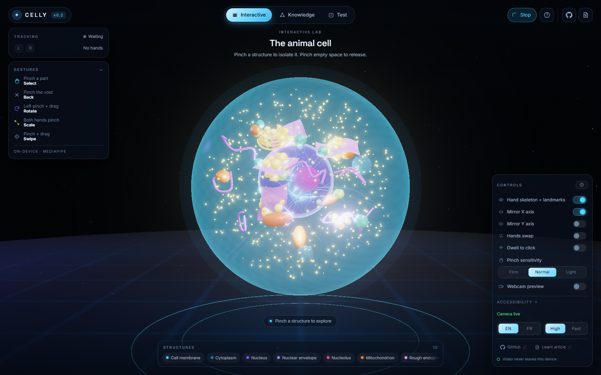
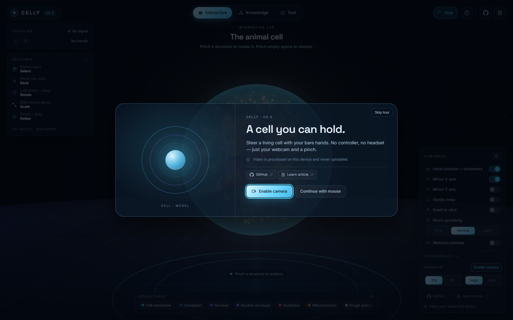
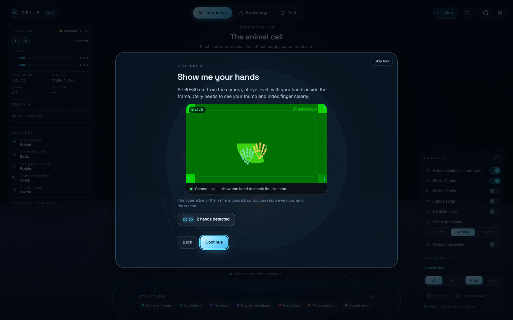
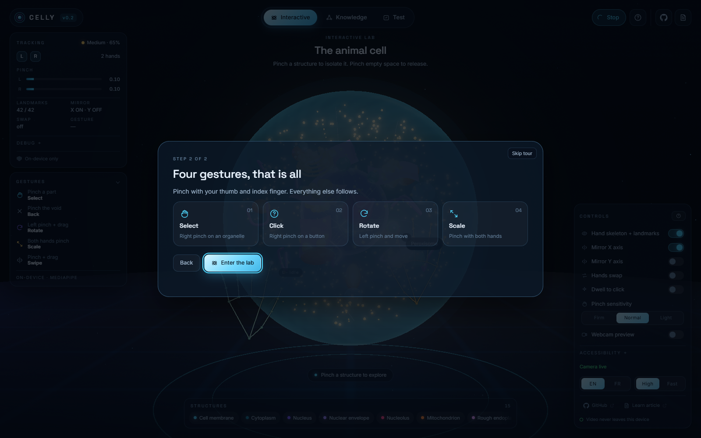
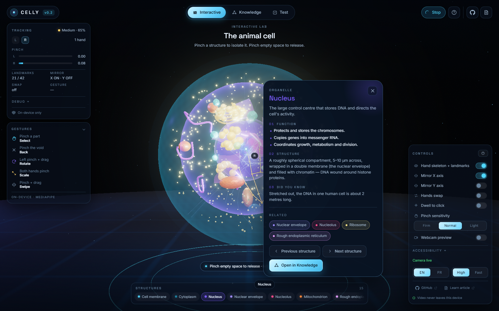
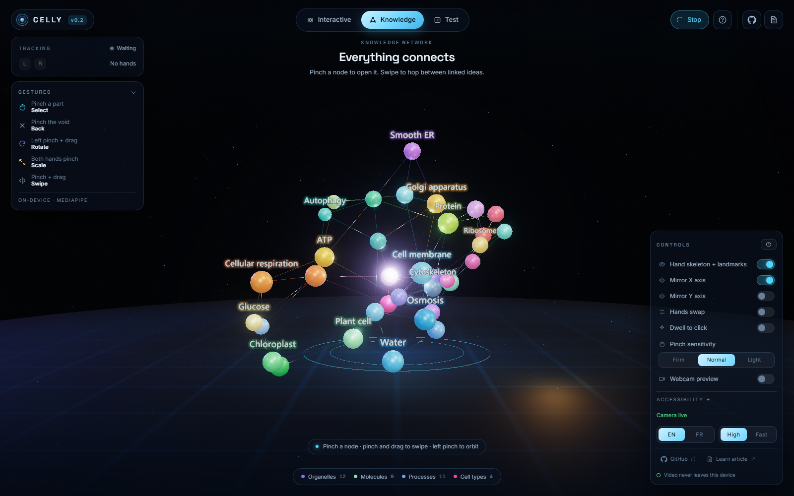
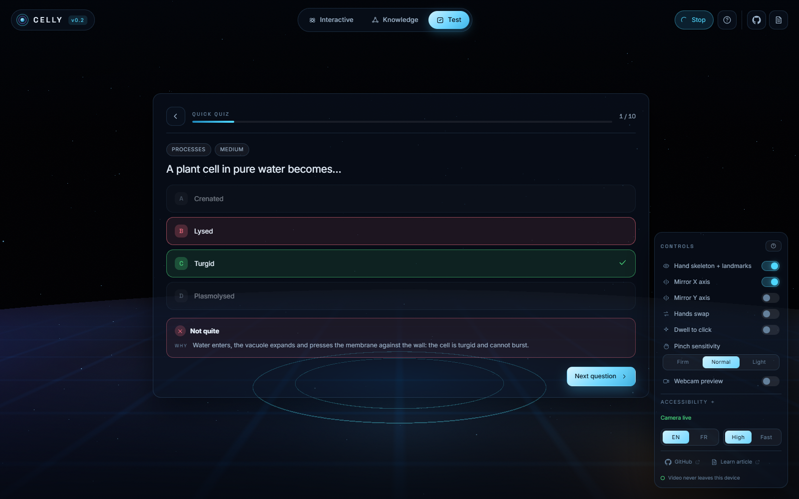
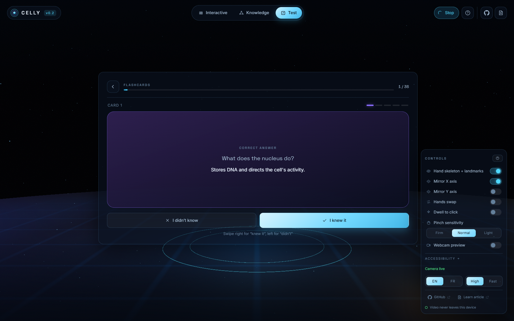
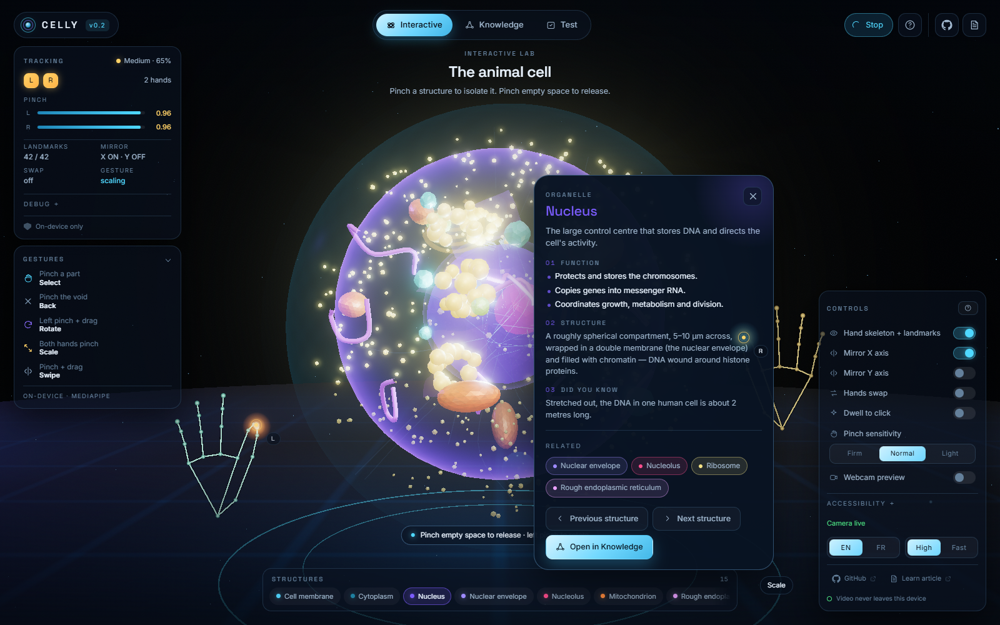
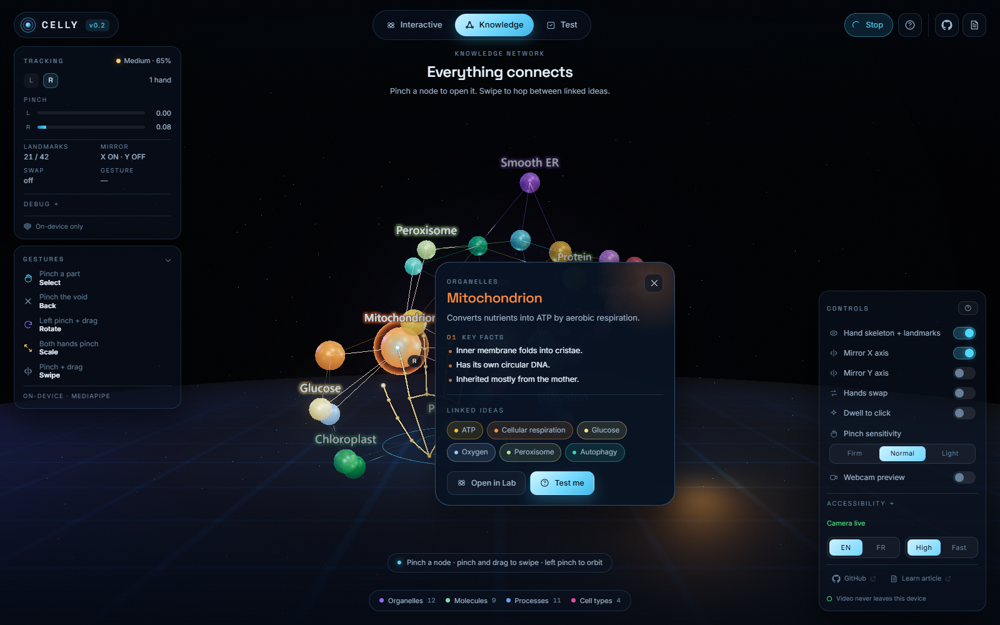

# Celly v0.2

[**Live demo**](https://celly-epp.pages.dev) · [**Demo video**](https://youtu.be/AT4qeiaPZDg) · [**Source on GitHub**](https://github.com/UlkhadPharaon/Celly) · [**Learn article**](https://medium.com/@ulrichtapsoba2009/how-to-make-school-more-valuable-94ac46cecc32?sharedUserId=ulrichtapsoba2009)

**A touch-free 3D cell biology lab.** Celly puts a living, procedural cell in front of you and lets
you explore it with your **bare hands** — no controller, no headset, no gloves. A webcam and a pinch
are the entire interface, with the mouse and keyboard kept as a first-class fallback.

> **The story behind Celly:** [How to make school more valuable — what a 3D cell you can hold
> changes about learning](https://medium.com/@ulrichtapsoba2009/how-to-make-school-more-valuable-94ac46cecc32?sharedUserId=ulrichtapsoba2009).

**Watch it in use:** [Celly demo on YouTube](https://youtu.be/AT4qeiaPZDg)

The app has three sections:

| Section | What you do |
|---|---|
| **Interactive Lab** | Rotate, scale, isolate and read 15 organelles on a ray-marched-looking 3D cell. |
| **Knowledge** | Fly through a 36-node graph of cell-biology concepts and hop between related ideas. |
| **Test** | Quick quiz, full exam, guided questionnaire sets and Leitner flashcards, all gesture-driven. |



---

## The study mode (research build)

Celly is also an instrument for comparing **three ways of learning the same material**. On first
launch a participant picks a condition, and that choice is recorded as data — not a cosmetic
preference:

| Condition | What the participant gets |
|---|---|
| **Hand tracking** | The 3D cell driven by bare-hand pinches through the webcam. |
| **Mouse** | The same 3D cell driven by clicks and dragging. The camera never starts. |
| **Textbook** | The same content as a written textbook page: eight chapters, figures described in words, no 3D and no camera. |

Every participant then follows the same path: **read or explore → a 10-question quiz → a short
survey → a completion screen with an anonymous participant code**. Nothing is uploaded; each
profile is stored on the device and can be exported as CSV or JSON for analysis.

The survey asks the four questions the comparison needs — how hard it was, how different it was
from their usual studying, how effective it felt, and whether they would study this way again —
plus a 0–10 recommendation and a free-text comment.

### Running the study

1. Open the app. The **mode gate** appears before any UI is shown.
2. Pick a condition. Hands and mouse participants get a short onboarding and a guided tour of the
   interface; the textbook condition goes straight to the reading.
3. Finish the quiz and the survey. The completion screen shows the participant code
   (`CL-XXXXXX`) and offers a JSON download of that one profile.
4. The researcher opens **Study data** (the chart button in the top bar, or `G`) to see every
   participant on the device, the per-mode comparison, and the exports.

### Export schema

`celly-study.csv` has one row per participant:
`participant_id, mode, language, started_at, ended_at, duration_seconds, reading_seconds,
tour_completed, quiz_correct, quiz_total, quiz_ratio, quiz_seconds,
difficulty_1_easy_5_hard, difference_1_same_5_different, effectiveness_1_worse_5_better,
preference, recommend_0_10, comment`.

`celly-study-answers.csv` has one row per answered question
(`participant_id, mode, question_id, correct, seconds`) for item-level analysis.
`celly-study.json` contains the raw sessions plus the aggregated per-mode means.

Keyboard shortcuts added for the study: **S** opens the study quiz, **G** opens the study data.

Profiles live in `localStorage` under `celly:v03:session` (the run in progress) and
`celly:v03:archive` (completed participants), and every field is re-validated on read, so a
corrupted or newer payload degrades to a fresh session instead of poisoning the dataset. The
quiz ratio always uses the questions **served** as its denominator, so a participant who stops
half-way is still counted correctly.

---

## Contents

- [Quick start](#quick-start)
- [The study mode (research build)](#the-study-mode-research-build)
- [The gesture vocabulary](#the-gesture-vocabulary)
- [What is in the box](#what-is-in-the-box)
- [How hand tracking works](#how-hand-tracking-works)
- [Architecture](#architecture)
- [Testing](#testing)
- [Privacy](#privacy)
- [Accessibility](#accessibility)
- [Performance and browser support](#performance-and-browser-support)
- [Scripts](#scripts)
- [Documentation](#documentation)
- [Licence](#licence)

---

## Quick start

```bash
npm install
npm run dev          # http://localhost:5173
```

Requirements: **Node 24+**, a browser with **WebGL2** and **WASM**, and a webcam for gesture mode.
Chrome or Edge give the most predictable MediaPipe performance; Safari 17+ also works.

`npm install` runs `scripts/fetch-assets.mjs`, which

1. copies the MediaPipe WASM runtime out of the pinned npm package into `public/mediapipe-wasm/`,
2. downloads `public/models/hand_landmarker.task` (7.8 MB) once if it is missing, and
3. removes any stale `public/hands_*.glb` left by an older checkout.

Everything is served locally after that — no CDN, no per-frame network calls. The hands are drawn from
MediaPipe landmarks at runtime, so there are no hand meshes or hand textures to download.

> **No camera?** Choose **Continue with mouse** on the welcome card. Every gesture has a pointer
> equivalent (click = pinch, drag = rotate, wheel = scale), so the app is fully usable without one.

### Production build

```bash
npm run build        # type-check + Vite build -> dist/
npm run preview      # serve dist/ locally
```

The build is static. Serve `dist/` behind HTTPS (or `localhost`) — browsers only grant camera access
in a secure context.

### Deploy to Cloudflare Pages (live host)

The live demo is a **Cloudflare Pages** project named `celly`, built from the `main` branch of
[`UlkhadPharaon/Celly`](https://github.com/UlkhadPharaon/Celly) and served at
**<https://celly-epp.pages.dev>**.

`wrangler.toml` at the repository root carries the two settings the Git build needs:

```toml
name = "celly"
pages_build_output_dir = "dist"

[vars]
CELLY_VERSION = "0.2.2"
```

The Pages project itself must also have a build configuration (dashboard → *Settings* → *Builds &
deployments*):

| Setting | Value |
|---|---|
| Build command | `npm run build` |
| Build output directory | `dist` |
| Production branch | `main` |

Both halves matter. Without `pages_build_output_dir` the build publishes the repository root, so the
site serves the **source** `index.html` with `<script src="/src/main.ts">` — a module that does not
exist in a browser, which renders as a black screen. Without a build command the build fails in
seconds with nothing to publish.

`npm run build` runs `fetch-assets.mjs` as a `prebuild` step, so the pinned MediaPipe WASM and model
are present in `dist/` even on a clean build image. Nothing else is required: no environment
variables, no server functions, no database. Cloudflare provides the HTTPS secure context the camera
needs.

A direct upload is also possible, and is how the first working deployment was made:

```bash
npm run build
npx wrangler pages deploy dist --project-name celly --branch main
```

### Deploy to Vercel (alternative)

The repo also ships a `vercel.json` for a static Vite deployment: Node 24, `npm ci`,
`npm run build` and `dist/` as the output. Import
[`UlkhadPharaon/Celly`](https://github.com/UlkhadPharaon/Celly) at
[vercel.com/new](https://vercel.com/new), name the project `celly` (Vercel project names must be
lowercase) and keep the detected Vite settings. For a CLI deploy, create and link that lowercase
project once:

```bash
vercel project add celly
vercel link --yes --project celly
vercel --prod
```

The response headers allow `camera` for the same origin, disable microphone and geolocation, and
cache the hashed bundles immutably. Hand geometry is generated at runtime, so the deployment carries
no hand mesh, rig or texture assets.

---

## The gesture vocabulary

| Gesture | Result |
|---|---|
| **Right pinch** on an organelle or node | **Select** — focus it, dim the rest, open the info card |
| **Right pinch** on empty space | **Unselect** — restore the cell (also closes an open card) |
| **Right pinch** on a button | **Click** (release within 500 ms and 24 px) |
| **Left pinch + move** | **Rotate** the cell / graph — absolute, follows the palm |
| **Both hands pinch** | **Scale** — spread to grow, bring together to shrink |
| **Pinch + horizontal drag** | **Swipe** — next/previous (Knowledge and Test) |

Rotation is **absolute, not accumulated**. The palm position at the start of the gesture anchors to
the rig's current rotation, and the rig eases toward `anchor + (palm − anchorPalm) × gain`. A still
hand therefore gives a still target, a tremor cannot reverse the direction, and nothing drifts. The
per-frame delta is normalised by the viewport and clamped, so one bad detection cannot whip the
model. The gain lives in `ROTATE_GAIN` at the top of `src/pages/interactiveLab.ts`.

Scale is measured against the hand separation **at the moment both pinches land**: spreading the
hands scales up, bringing them together scales down, and a small deadzone stops the cell creeping
while the hands are held still. A two-hand pinch always wins over a rotate in progress.

**Reset view** in the control panel returns rotation, scale and selection to the default framing in
one press — both are gestures, so without it a reload was the only way back.

Pinch strength is a dead-zoned ratio of tip gap to **palm width**, not to wrist length:

```
r     = |tip(4) - tip(8)| / |mcp(5) - mcp(17)|
pinch = 1 - smoothstep(0.10k, 0.55k, r)
```

`k` is the sensitivity chosen in the control panel — **Firm 0.8 / Normal 1.0 / Light 1.3** — so
the same hand can be tuned to a camera, a hand size or a lighting setup without touching code. The
image-space ratio is the primary signal; metric world landmarks are blended in only when they agree
with it, because MediaPipe's z is the noisiest axis at arm's length. Real finger pads touch while
the marker centres stay a centimetre or two apart, so the dead zone makes a natural pinch read 1
instead of stalling in the 0.5–0.6 range.

A pinch becomes active above **0.55** and releases below **0.20** (hysteresis, so the pinch does
not chatter at the threshold). A held frame is not overdamped: `minHoldMs` is **0**, because the
travel budget rather than the clock separates a click from a drag. Fists and incomplete hands are
rejected. Losing the hand for less than **550 ms** does
not cancel a gesture.

Pointer movement maps the middle **84 %** of the camera frame (8 % → 92 %) onto the full viewport, a
~1.19× gain clamped at the edges, so every corner of the screen is reachable without leaning out of
frame. Sit **60–80 cm** back at eye level; the webcam preview and the onboarding hands check show the
usable frame as a dashed box.

The gesture state machine is `IDLE → HOVER_UI / SELECTING / ROTATING / SCALING / SWIPING`, with a
**150 ms cooldown** after a two-hand scale so the release cannot fire a stray select. A two-hand
pinch always overrides a rotate in progress. While an info card is open, a pinch that lands on the
cell dismisses the card instead of selecting through it, so a near-miss on the close button no longer
picks a different organelle.

The **HUD** (top-left) reports hands seen, L/R chips, live pinch value and bar, landmark count,
tracking quality (`Good / Medium / Poor` + %), mirror state, and both tracker and render FPS. The
gesture legend sits directly beneath it in the same left rail; the rail collapses automatically on
short viewports, the HUD keeps only its header and hand count while no hands are detected, and the
Test page hides the rail entirely so telemetry never covers the question cards.

On phones and tablets the shell becomes touch-first: the HUD is hidden at ≤820 px, the control panel
collapses into a bottom sheet, the structure rail sits above the collapsed sheet, overlays reserve
the sheet's height, and controls use safe-area padding with 44 px rows, switch hit areas, tabs and
icon buttons on coarse pointers. The sheet can still be opened by pinch: its header is registered
with the gesture button registry.

| Welcome | Hands check | Gesture primer |
|---|---|---|
|  |  |  |

---

## What is in the box

### Interactive Lab



- **15 organelles**, every one a separate, named, raycastable group: membrane, cytoplasm, nucleus,
  nuclear envelope, nucleolus, mitochondrion, rough ER, smooth ER, Golgi, ribosome, lysosome,
  vacuole, centriole, cytoskeleton, peroxisome.
- Auto-rotation on by default with a **Stop** control (top-right); the left hand rotates, two hands
  scale, and a pinch selects.
- Selecting **focuses** the part: the rest of the cell dims to 32 % rather than vanishing, so the
  model stays readable in context. The card offers **Isolate** (drops the rest to 10 %), **Undo**,
  and **Open in Knowledge**; Undo clears both the isolation and the selection.
- The card is deliberately short — a summary and up to three functions. Structure, the fun fact and
  the related links live on the Knowledge page, so the action buttons never get pushed off screen.
- A bottom **structure rail** lists all 15 parts for direct selection, in gesture or mouse mode.
- **Reset view** (control panel) restores rotation, scale and selection together.

### Knowledge



- **36 authored nodes** (Organelles, Processes, Molecules, Techniques, Genetics) and ~90 edges in a
  deterministic 3D force layout — the same graph every load.
- Billboarding labels, category colours, travelling-light edges, hover focus.
- Pinching a node flies the camera in, dims non-neighbours and opens the overlay; related chips hop
  to adjacent concepts. The focused node can still be rotated and scaled.
- "Open in Lab" and "Test me" carry the concept across sections.

### Test

| Quiz | Flashcard |
|---|---|
|  |  |

- **48 multiple-choice questions** with explanations, difficulty tags and links back to the graph.
- **36 flashcards** on a Leitner schedule (boxes 1–5). Each back restates the question above the
  answer. Swipe **right = "I knew it"**, **left = "I didn't"**; retrieval state persists in
  `localStorage` under `celly:v02:leitner`.
- **3 guided questionnaire sets** of 10 questions each: *Cell basics*, *Energy & transport*,
  *Genetics & division*.
- Progress, best score and attempts persist under `celly:v02:progress`.
- Review screen lists every mistake with the correct answer and an explanation.

| Two-hand scale | Result |
|---|---|
|  |  |

---

## How hand tracking works

- **Model:** MediaPipe Tasks Vision `HandLandmarker` (float16, 1.1.0), `numHands: 2`, running in a
  **dedicated worker** (`src/tracking/trackingWorker.ts`) so inference never blocks the render loop.
  The camera is captured on its own clock and the worker reports detections as they complete; the
  main thread only consumes finished results. There is no server round-trip.
- **Assets:** WASM and the `.task` model are served from `public/` — the app is offline-capable
  after its first load and never sends a frame anywhere.
- **Thresholds:** hand detection 0.55, presence 0.45, tracking 0.35. Detection is the strict gate
  (it is where false positives come from); tracking is deliberately permissive, because at 0.5 a
  hand that was already being tracked was dropped for a single weaker frame, which read as the
  skeleton flashing. A hand is only declared lost after **550 ms** without a detection, long enough
  to bridge a slow re-detection after a pinch without leaving a ghost behind.
- **Landmarks:** 21 per hand in normalized image space plus metric **world** landmarks. MediaPipe's
  world axes are image-aligned (y down, z negative toward the camera); Celly converts once in
  `handTracker.detect()` to a y-up, +z-toward-viewer frame.
- **Smoothing:** a One-Euro filter (`landmarkFilter.ts`) removes jitter without adding perceptible
  lag; the raw stream stays available in the debug view.
- **Sides:** MediaPipe's handedness assumes a mirrored selfie image, so the label is flipped once,
  then the user's **Swap L/R** correction is applied. Assignments are matched to the nearest wrist
  and debounced for 150 ms so the labels never flicker.
- **Quality:** a 0–100 score from landmark confidence, hand size and frame coverage drives the
  Good/Medium/Poor readout.
- **Mirroring:** `Mirror X` (on by default) and `Mirror Y` (off) are display transforms. The tracker
  output is untouched; each frame's world landmarks are mirrored once into display space, and the
  pointer mapping mirrors normalized image coordinates. The skeleton therefore matches the mirrored
  preview without ever flipping the underlying hand data twice.
- **3D hands:** a **lightweight 21-joint skeleton**, not a skinned mesh. Each hand is 21 rounded
  points plus 21 bone segments — the five finger chains and four palm links (`0→17`, `5→9`, `9→13`,
  `13→17`) so the palm reads as a hand. Left is mint (`#7ee0c3`), right is amber (`#ffd166`); the
  index tip is white, the pinch tips warm white, and a soft amber glow marks the pinch point. A dark
  4.5 px underlay beneath the 2.2 px coloured bones and a rimmed joint shader keep the skeleton
  readable over the bright membrane and bloom. Joints use a constant CSS-pixel size, draw on top of
  the cell, and are scaled from the metric palm span rather than screen distance. The index tip is
  placed on the camera ray through the tracked cursor, so the skeleton tip and the pointer coincide
  at any viewport size or field of view. There are no GLB, low-poly or procedural hand paths left:
  the skeleton is the only hand renderer.
- **Selection:** every organelle instance has its own pick anchor and enlarged proxy. A pinch
  freezes the hovered target, uses the aim from ~100 ms before the pinch, then commits on **release**
  after a ≥100 ms hold within 36 px. The built-in Selection test (`T`) reports hit rate and mean aim
  error; see the pose/debug screenshots in [`docs/screenshots/hand-tests/`](docs/screenshots/hand-tests/).

The synthetic-hand path used by the screenshots and e2e tests (`window.__celly.injectHand`) feeds a
full 21-landmark hand through the exact same pipeline — hover, state machine, intents — so what the
tests exercise is what a camera produces.

---

## Architecture

```
src/
  core/        app shell, render loop, page router, tween engine, store, math, replay hand,
               device profiles (phone/tablet/desktop budgets and quality defaults)
  tracking/    camera, HandLandmarker worker, One-Euro filter, side resolver, quality
  gestures/    pinch hysteresis, gesture state machine, virtual cursors
  scene/       one renderer/scene: cellModel, knowledgeScene, skeletonHand, handLayer, textures,
               shapes
  ui/          shell, tabs, HUD, overlay, collapsible control panel, onboarding, cursor layer,
               webcam preview, mode gate, guided tour, research panel
  pages/       interactiveLab, knowledge, study (studyLayer, textbook, chapters), testing/{testingPage, leitner, progress, session}
  study/       research instrument: types, store, quiz, survey, mode copy, tour steps, download
  data/        organelles.json, knowledge.json, questions.json, catalog helpers
  styles/      design tokens, glass/grain, layout, cursor, responsive sheet/safe-area rules
tests/
  unit/        pinch, side resolution, gesture engine, Leitner/progress, data integrity,
               study store
  e2e/         smoke + synthetic-hand replay (Playwright)
scripts/
  fetch-assets.mjs   local WASM/model provisioning + stale hand-mesh cleanup
  shots.mjs          11 docs screenshots via synthetic hands
```

- **One** `WebGLRenderer` and **one** `Scene` for the whole app. Pages are groups
  (`labGroup`, `knowledgeGroup`, `testGroup`) toggled by the router; the 3D hands live in
  `handGroup` and persist across pages, so navigating never re-initialises the GPU.
- **State** is a tiny typed store with explicit subscriptions — no framework.
- **Animation** is a custom tween engine (easing, cancellation, completion) plus a per-frame damp
  for continuous input. No animation library.
- **Text** is DOM, not canvas: selection, screen readers, i18n and responsive layout come for free.
  Only the cell, graph and hands are WebGL.
- **Content** is typed JSON behind `src/data/catalog.ts`; the unit tests enforce the content
  minimums and referential integrity.

A detailed rationale for every structural choice is in [`DECISIONS.md`](DECISIONS.md); the original
research and asset audit are in [`docs/RESEARCH.md`](docs/RESEARCH.md) and
[`ASSET_INVENTORY.md`](ASSET_INVENTORY.md).

---

## Testing

```bash
npm test             # Vitest: 19 files, 187 unit tests
npm run test:e2e     # Playwright: 18 specs, 31 tests (smoke + gesture replay)
npm run lint         # ESLint (flat config, typescript-eslint)
npm run typecheck    # tsc --noEmit, strict
npm run build        # typecheck + production bundle
```

Unit coverage:

- pinch value, fist rejection, enter/exit hysteresis, minimum hold, invalid input;
- MediaPipe side flip, manual swap, nearest-wrist slot matching, 150 ms debounce, loss handling;
- every gesture-state transition: select/unselect, click budget, swipe, rotate, two-hand scale,
  cooldown, hand-loss reset, dwell-to-click;
- pre-pinch aim look-back, screen-space proximity, cursor mapping and reach;
- 13 deterministic hand-pose fixtures, index-tip anchoring and fast-movement sequences;
- phone/tablet/desktop device profiles, DPR clamps, quality defaults, antialias policy, camera
  constraints and touch-laptop classification;
- Leitner promotion/demotion, ordering, persistence and corrupt-storage sanitising;
- scoring labels, best-ratio persistence;
- content minimums and integrity: 15 organelles, 36 nodes, 48 MCQs, 36 cards, 3 sets, bilingual
  coverage, valid links, four distinct options per question;
- the study instrument: session sanitisation, quiz ratio with a stable denominator, per-mode
  aggregation and CSV/JSON export shape (`tests/unit/studyStore.test.ts`);
- rotation sensitivity: a fifth-of-screen sweep must produce a visible turn, a tremor must not, and
  a single large jump must be capped.

E2E runs with a fake camera (Chrome's test pattern) so MediaPipe initialises, then injects synthetic
21-landmark hands through the real pipeline; it selects an organelle, opens and closes the overlay,
navigates the knowledge graph and verifies the two-hand scale state. No physical webcam is required.

Regenerate the documentation images with the dev server running:

```bash
node scripts/shots.mjs
node scripts/verify-hands.mjs   # pose suite, debug/selection screenshots, hand metrics
```

The harness boots Chrome with ANGLE SwiftShader (`--use-angle=swiftshader`, not `--disable-gpu`) and
a matching 1600×1000 window. Software compositing produced stale, rescaled page copies; pinning ANGLE
keeps composition normal. Stills also disable `backdrop-filter`, transitions and keyframes, freeze
the camera at the configured framing, and wait for the overlay's computed visibility, so a slow
compositor cannot capture a half-faded card.

---

## Privacy

- Camera frames are processed **on this device** in WebAssembly. Nothing is uploaded, recorded or
  persisted.
- The only network requests are the initial page assets; the model and WASM are self-hosted.
- No analytics, no cookies, no accounts. Learning state lives in `localStorage` and can be cleared
  from the control panel.

## Accessibility

- Full **mouse + keyboard** path; the onboarding offers it before the camera is ever requested.
- **Reduce motion** and **high contrast** toggles in the control panel; both persist.
- All interactive UI is real `<button>` / `<summary>` elements with labels and focus styles.
- Live regions announce the selected organelle and quiz feedback.
- Interface language **EN / FR**, switching instantly without a reload.
- The HUD and gesture legend are `pointer-events: none` so telemetry can never swallow a click.

## Performance and browser support

Rendering is capped at the display refresh; tracking runs at 24 fps on phones and 30 fps on
tablets/desktops. The hands are a skeleton overlay — 21 points and 21 line segments per hand — not a
skinned mesh: no bone matrices, skinning pass or hand textures. Each hand adds three draw calls (dark
bone underlay, coloured bones, joints) and an optional pinch sprite. With one skeleton hand in frame,
the Lab measured **83 draw calls and 79,522 triangles** at 1280×800. The Knowledge graph remains the
heaviest page. `window.__celly.renderStats` exposes live quality, device class, DPR, calls,
triangles, points and texture counts for audits.

Device profiles in `src/core/device.ts` choose the budget before the first frame:

| Profile | Default quality | DPR cap | Shadows | Bloom | Dust | Camera |
|---|---|---|---|---|---|---|
| Phone | Fast (`low`) | 1.5 | off | off, even at High | 120 | 640×480 @ 24 fps |
| Tablet | Fast (`low`) | 1.75 | off | on at High | 220 | 960×540 @ 30 fps |
| Desktop | High | 2 | on at High | on at High | 420 | 640×480 @ 30 fps |

Fast quality renders at DPR 1, disables bloom/shadows and draws roughly half the dust. High quality
uses the profile's DPR cap and restores the full effects where the device supports them (bloom stays
off on phones). The dust drift is a GPU vertex shader — no per-frame CPU position upload — and the
render loop avoids camera, look-at, projection and preview allocations. The webcam thumbnail is
drawn at ~15 fps and skipped entirely while its sheet is collapsed.

The skeleton is drawn with depth testing off, above the cell and its bloom, with a dark line underlay
and a rimmed joint shader so it stays legible against the bright membrane. Its joints keep a constant
CSS-pixel size while the hand's 3D span still follows the tracked palm, so moving closer to the
camera does not turn the overlay into a wall of dots.

| Browser | Status |
|---|---|
| Chrome / Edge 111+ | Recommended |
| Safari 17+ | Supported (WebGL2 + WASM SIMD) |
| Firefox 121+ | Supported; MediaPipe CPU delegate can be slower |

A discrete or modern integrated GPU is recommended. The tracker tries the GPU delegate first and
reports the delegate that actually initialised (`gpu` or `cpu`) instead of assuming success; it
degrades to mouse mode if no camera is available.

---

## Scripts

| Script | Description |
|---|---|
| `npm run dev` | Vite dev server with HMR |
| `npm run build` | `tsc --noEmit && vite build` |
| `npm run preview` | Serve the production build |
| `npm run typecheck` | Strict type-check only |
| `npm run lint` | ESLint over `src`, `tests`, configs |
| `npm run format` | Prettier write for TS/CSS/Markdown/JSON |
| `npm test` | Vitest unit suite |
| `npm run test:watch` | Vitest in watch mode |
| `npm run test:e2e` | Playwright smoke + gesture replay |
| `node scripts/shots.mjs` | Regenerate `docs/screenshots` |
| `node scripts/verify-hands.mjs` | Hand pose/selection screenshots and raw metrics (dev server on :5173) |

## Documentation

- [`PLAN.md`](PLAN.md) — milestones and completion state
- [`DECISIONS.md`](DECISIONS.md) — every architectural ruling (D-01 … D-54)
- [`DIAGNOSIS_ROUND2.md`](DIAGNOSIS_ROUND2.md) — hand pivot, retargeting and selection root causes
- [`FINAL_REPORT_ROUND2.md`](FINAL_REPORT_ROUND2.md) — measured results, limitations and v0.3 plan
- [`docs/ARCHITECTURE.md`](docs/ARCHITECTURE.md) — scene graph, data flow, module contracts
- [`docs/RESEARCH.md`](docs/RESEARCH.md) — prior-art and asset research
- [Learn article: How to make school more valuable](https://medium.com/@ulrichtapsoba2009/how-to-make-school-more-valuable-94ac46cecc32?sharedUserId=ulrichtapsoba2009) - the story and design rationale
- [`ASSET_INVENTORY.md`](ASSET_INVENTORY.md) — what ships, where it came from, licence audit
- [`CREDITS.md`](CREDITS.md) — attribution for models, fonts, WASM and code
- [`CHANGELOG.md`](CHANGELOG.md) — v0.1 → v0.2

## Licence

MIT © 2026 Ulkhad Pharaon and Celly contributors. Third-party licences are listed in
[`CREDITS.md`](CREDITS.md).
